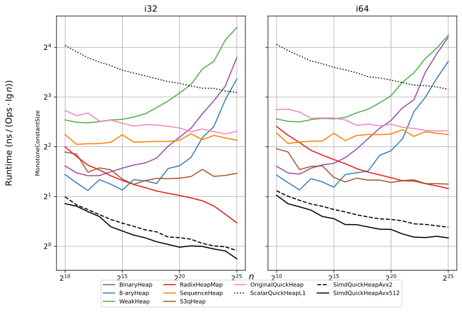

[](https://crates.io/crates/quickheap)
[](https://docs.rs/quickheap)
[](https://doi.org/10.48550/ARXIV.2604.25681)

# SimdQuickHeap: A fast SIMD-based priority queue

The SimdQuickHeap is, as the name suggests, a **fast priority queue**.
It has some similarities to QuickSelect, and uses SIMD for fast partitioning and
insertion of elements.

Unlike the classic binary heap (and $d$-ary heap variants), it is I/O-efficient
and **does not suffer from bad cache-locality** when the size of the queue exceeds
the cache.

Currently, it only supports `i32`, `u32`, `i64`, and `u64` keys and key-value pairs and requires
either AVX2, AVX-512, or NEON for SIMD acceleration, so build using e.g.:

```sh
RUSTFLAGS="-C target-cpu=native" cargo build --release
```

See the paper for details and benchmarks:

> SimdQuickHeap: The QuickHeap Reconsidered  
> Johannes Breitling, Ragnar Groot Koerkamp, Marvin Williams, ESA 2026  
> https://doi.org/10.4230/LIPIcs.ESA.2026.16

An older blog post can be found [here](https://curiouscoding.nl/posts/quickheap)
and P99 slides are [here](https://curiouscoding.nl/slides/simdquickheap.pdf).

## Example

``` sh
cargo add quickheap
```

```rust
let mut q = quickheap::SimdQuickHeap::<u64>::default();
q.push(4);
q.push(1);
q.push(7);
assert_eq!(q.pop(), Some(1));
q.push(7);
q.push(3);
assert_eq!(q.pop(), Some(3));
assert_eq!(q.pop(), Some(4));
assert_eq!(q.pop(), Some(7));
assert_eq!(q.pop(), Some(7));
assert_eq!(q.pop(), None);
```

With `(u64,u64)` key-value pairs:

``` rust
let mut q = quickheap::KvSimdQuickHeap::<u64>::default();
q.push(1, 123);
q.push(2, 0);
assert_eq!(q.pop(), Some((1, 123)));
assert_eq!(q.pop(), Some((2, 0)));
```

### C++ Bindings

See [`cpp/README.md`](cpp/README.md) for an example of using the C++ bindings.

## Results

See [`quickheap-dev/README.md`](quickheap-dev/README.md) for further information on
running the benchmarks.

Below you can see the results on an AMD Zen 4 EPYC 9684X for 32-bit and 64-bit
data. We first push `n` elements and then measure how long it takes on
average to do a pair of push and pop operations. Note that the y-axis is
logarithmic and normalized by both the number of elements and `log_2(n)` as
well, so that the $n \log_2 n$ comparison-based sorting bound would come out as
a horizontal line.

The SimdQuickHeap is up to 50% faster than the Radix heap ([`iwiwi/radix-heap`](https://github.com/iwiwi/radix-heap)), and up to 10x faster
than the standard library [binary
heap](https://doc.rust-lang.org/std/collections/struct.BinaryHeap.html) and the
8-ary heap of [`orx-priority-queue`](https://crates.io/crates/orx-priority-queue).



In absolute terms of time for the average time per element (for both pushing and
popping it), the comparison is as follows when the queue has a constant size of
$n$ elements.
The last column shows the number of L2 cache misses per element for $n=2^{25}$.
The top half of the table is shown in the plot above, while the bottom half
contains additional implementations that are consistently slower.

| Implementation         | $2^{10}$ | $2^{15}$ | $2^{20}$ | $2^{25}$ | L2 misses |
| ---                    |      --- |      --- |      --- |      --- |       --- |
| BinaryHeap             |     27.3 |     45.8 |    104.1 |    439.5 |     13.25 |
| Orx-8-ary heap         |     25.6 |     33.2 |     73.4 |    297.6 |      8.27 |
| WeakHeap               |     61.6 |     92.7 |    175.8 |    482.0 |     20.11 |
| RadixHeap              |     36.5 |     38.9 |     42.5 |     44.8 |     0.065 |
| SequenceHeap           |     41.6 |     65.4 |     92.0 |    117.1 |      0.42 |
| S3qHeap                |     30.1 |     37.0 |     53.2 |     68.0 |      0.34 |
| OriginalQuickHeap      |     57.7 |     68.5 |     82.2 |     97.1 |      0.06 |
| ScalarQuickHeap        |    173.2 |    194.7 |    215.3 |    242.2 |      0.64 |
| SimdQuickHeapAvx2      |     27.0 |     29.0 |     32.3 |     35.5 |      0.09 |
| SimdQuickHeapAvx512    |     23.5 |     26.3 |     29.4 |     32.2 |      0.11 |
|                        |          |          |          |          |           |
| Orx-4-ary heap         |     20.3 |     35.3 |     64.0 |    348.4 |      8.03 |
| Boost-4-aryHeap        |     25.6 |     43.6 |     90.3 |    419.8 |      8.06 |
| 4-ary heap             |     23.7 |     43.5 |     73.7 |    320.5 |      8.07 |
| 8-ary heap             |     46.2 |     79.7 |    122.6 |    258.7 |     21.00 |
| RadixHeapMap           |     44.1 |     45.9 |     48.5 |     51.1 |      0.05 |
| PairingHeap            |    179.3 |    300.4 |    750.2 |   1963.6 |    26.245 |
| FibonacciHeap          |    389.1 |    608.9 |   1270.5 |   2313.2 |     82.46 |
| BoostFibonacciHeap     |    122.3 |    216.4 |    719.2 |   2027.8 |     54.29 |
| BoostPairingHeap       |    260.5 |    409.8 |   1112.4 |   2981.6 |     52.28 |
| BoostBinomialHeap      |    465.4 |    739.2 |   1525.8 |   2671.6 |     34.01 |
| BoostSkewHeap          |    103.3 |    229.0 |    764.1 |   2754.1 |     35.84 |
| ReimplementedQuickHeap |     58.6 |     76.9 |     95.8 |    115.9 |      0.04 |
